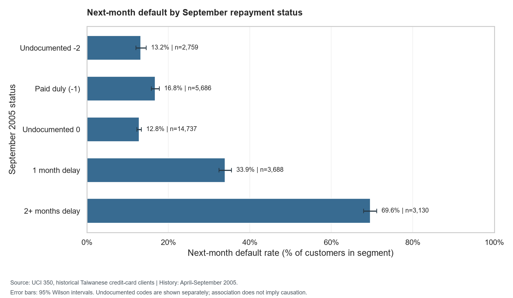

# Credit Risk & Repayment Behaviour Analytics

An intermediate data analyst portfolio project for Finnable interview preparation,
focused on SQL, Python, repayment behaviour, risk, collections questions, and clear
business communication.

Current status: **core stages 1-7 implemented**: validated data, three SQLite
tables, ten reconciled SQL analyses, seven exploratory charts, Power BI CSVs,
an editable three-page native Power BI project, and actual findings with recommendations.
The end-to-end run records its current status in `reports/project_status.json`.
Verification: the complete offline pipeline and all **44 regression tests** pass.
The native `.pbip` project contains the model, 18 DAX measures, and report visuals.
The completed `.pbix` is saved with imported data. It was reopened in Desktop,
and all **90 DAX checks** passed against that saved report (18 measures across
five filter scenarios). See `reports/powerbi_dax_validation.json` for results.
All three saved report pages rendered correctly after reopening. Visual checks,
filter checks, and file hashes are recorded in
[Power BI validation evidence](reports/powerbi_runtime_validation.json).

The selected source is [UCI Default of Credit Card Clients, dataset 350](https://archive.ics.uci.edu/dataset/350/default+of+credit+card+clients).
It is historical Taiwanese credit-card data with repayment history from April to
September 2005, not Finnable data. Monetary values are New Taiwan dollars (NTD),
not Indian rupees. See [source and attribution](docs/data_source.md).

## Run the complete core project

Windows PowerShell, from this workspace:

```powershell
Set-Location 'C:\Users\Sachin\OneDrive\Documents\Desktop\DS_Project'
powershell -NoProfile -ExecutionPolicy Bypass -File .\scripts\setup.ps1
.\.venv\Scripts\python.exe -m src.run_project --offline
```

The real source files are already present locally. On a fresh checkout, omit
`--offline` on the first run so the original UCI archive can be downloaded.
The pipeline checks the environment, prepares data, rebuilds SQLite, executes
SQL, creates figures and exports, and generates the findings report. It stops
on a failed check and marks the latest run failed; do not use stale output as
if a failed run succeeded. No Power BI software or remote account is required
to reproduce the Python/SQL work.

Run the regression checks:

```powershell
.\.venv\Scripts\python.exe -W error -m unittest discover -s tests -v
```

## Open the Power BI report

Open [Credit_Risk_Repayment_Analytics.pbix](powerbi/Credit_Risk_Repayment_Analytics.pbix)
in Power BI Desktop on Windows. Its imported data is already saved; explore
the portfolio, repayment history, and cohort investigation pages immediately.
The editable [native project](powerbi/Credit_Risk_Repayment_Analytics.pbip)
is also available. When opening a fresh native project, choose **Refresh** to
load the four exported CSVs. Both formats include types, relationships, sort
orders, 18 measures, and 39 visuals.

If the workspace moves, use **Transform data > Manage Parameters** to change
`DataFolder` to the new absolute `data\exports` directory. Apply changes and
refresh. The [dashboard guide](powerbi/dashboard_guide.md) covers the numerical
and filter checks, plus the **Save As > Power BI report (.pbix)** step for
reproducing the saved report. No cloud publishing or sign-in is required.

To regenerate the native project after changing the source code or DAX:

```powershell
.\.venv\Scripts\python.exe -m src.export_powerbi
.\.venv\Scripts\python.exe -m src.build_powerbi_project
```

Close Desktop before regeneration. The generator replaces its authored model
and visual definitions, so save a separate copy before making manual report
changes that you want to keep. A `.pbip` needs its sibling `.Report` and
`.SemanticModel` folders; sharing only the small `.pbip` file is insufficient.
The generator backs up Desktop-converted TMDL definitions under
`.cache/powerbi_backups` before writing its model.bim format. The saved `.pbix`
is a local deliverable and is excluded from Git by `.gitignore`; include it
explicitly when sharing your portfolio outside Git.

## Start reviewing here

- [Business findings and recommendations](reports/business_findings.md):
  observed results, proposed actions, and limits of the evidence.
- [Ten SQL analyses](docs/stage_04_sql.md): business questions, denominators,
  CTEs, CASE, joins, LAG, NTILE, and independent Pandas reconciliation.
- [Exploratory analysis](docs/stage_05_eda.md): seven charts with group sizes,
  units, and uncertainty intervals.
- [Native Power BI project](powerbi/Credit_Risk_Repayment_Analytics.pbip),
  [dashboard guide](powerbi/dashboard_guide.md), and
  [18 DAX measures](powerbi/measures.dax): four exports, relationships, three
  report pages, filter behaviour, and numerical checks.
- [Source documentation](docs/data_source.md) and stage guides under `docs/`:
  interview explanations and reproducible commands.



## Actual findings and business interpretation

- **Sample baseline:** 6,636 defaults among 30,000 customers, or **22.12%**.
- **Recent delay:** September's two-or-more-month delay group has 2,177 defaults
  among 3,130 customers (**69.55%**). Documented paid-duly status has 954 among
  5,686 (**16.78%**). The recent-delay group is 10.43% of customers and contains
  32.81% of the sample's defaults; this is retrospective concentration, not
  measured collections effectiveness.
- **Repeated delays:** three or more documented-delay months are associated
  with 2,246 defaults among 3,744 customers (**59.99%**). No positive delay code
  is associated with 2,334 among 19,931 (**11.71%**), but that group includes
  undocumented states and cannot be called always on-time.
- **Credit-limit association:** below 50,000 NTD, the rate is 36.07% (n=4,311),
  compared with 15.13% at 200,000 NTD or more (n=11,150). This is not evidence
  that raising limits reduces risk.
- **Data comparability:** code 1 occurs 28 times in August and 3,688 times in
  September. Review coding/timing before treating the change as deterioration.

**Recommended next business steps:** pilot supportive outreach for recent and
repeated documented delays; compare incremental resolution, contact success,
complaints, and cost with an appropriate control. Resolve undocumented codes
with data owners and retain their coverage in reporting. Validate these signals
on current, representative customer data before considering any deployment.
No uplift, cost savings, or recovery ROI is estimated from this dataset.

Groups above overlap and must not have their default counts added together.
All results are associations, not proof of causation. The detailed generated
findings report connects each observation to its proposed test and limitations.

## Run stage 1 in Windows PowerShell

```powershell
Set-Location 'C:\Users\Sachin\OneDrive\Documents\Desktop\DS_Project'
powershell -NoProfile -ExecutionPolicy Bypass -File .\scripts\setup.ps1
```

This creates or reuses `.venv`, installs the core dependencies, checks them, and
saves `reports/environment_check.json`. It captures exact package versions in
`requirements-lock.txt` on the first successful run; subsequent setup runs use
that file. Internet access is needed for packages that are not already installed
or cached. Setup does not download the dataset or run later stages.

`-ExecutionPolicy Bypass` applies to this PowerShell process. It does not change
your saved execution policy, and you do not need to activate the environment.

To repeat just the local checks:

```powershell
.\.venv\Scripts\python.exe .\scripts\check_environment.py
```

Success ends with `Stage 1 checks passed.` Check
[the stage 1 guide](docs/stage_01_setup.md) for explanations and troubleshooting.

## Run stage 2: download, clean, and validate

From the project root, after stage 1:

```powershell
.\.venv\Scripts\python.exe -m src.prepare_data
```

This downloads the official source if needed, checks the recorded raw-file
checksums, and regenerates the clean customer CSV and quality reports. To rerun
using only the already-downloaded files:

```powershell
.\.venv\Scripts\python.exe -m src.prepare_data --offline
```

See [the stage 2 guide](docs/stage_02_data_preparation.md) for cleaning decisions,
file descriptions, and an interview explanation. The generated
[quality summary](reports/stage_02_summary.md) and
[validation report](reports/data_quality.json) contain the observed results.

## Run stage 3: build and validate SQLite

```powershell
.\.venv\Scripts\python.exe -m src.build_database
```

This requires a successful stage 2 and a matching clean-file checksum. It builds
and validates a temporary database before replacing the generated
`database/credit_risk.sqlite`. Rebuilding recreates the three tables from source;
it does not append another copy. Keep personal edits or extra tables in a separate
database. This is a local offline step and needs no database server or new package.

To validate the existing database without changing its contents:

```powershell
.\.venv\Scripts\python.exe -m src.build_database --validate-only
```

The tables contain 30,000 customers, 180,000 customer-month repayment records,
and 30,000 customer outcomes. Every stored value is reconciled to the verified
clean CSV, and every customer has six history months and one outcome. The target
appears only in `default_outcomes`; it is not copied into every monthly row.

Read [the stage 3 guide](docs/stage_03_sqlite.md),
[schema](sql/schema.sql), and [generated validation summary](reports/stage_03_summary.md).
`sql/check_join_grain.sql` demonstrates why a direct monthly join repeats the
6,636 default flags six times, giving an invalid customer count of 39,816. This
is a correctness diagnostic; the ten business analyses are in `sql/analyses/`.

## Run stages 4-7 individually

```powershell
.\.venv\Scripts\python.exe -m src.run_sql_analysis
.\.venv\Scripts\python.exe -m src.explore_data
.\.venv\Scripts\python.exe -m src.export_powerbi
.\.venv\Scripts\python.exe -m src.write_findings
```

Stage 4 compares every SQL result with an independent Pandas calculation.
Stage 5 saves PNGs under `reports/figures/`. Stage 6 exports enriched customers,
monthly repayments, outcomes, and a month dimension under `data/exports/`;
it also checks reference filter scenarios. Stage 7 requires those reports to
have passed for the same database before publishing business findings.

## Observations from the downloaded file

- 30,000 customers and 25 source columns; no missing cells or duplicate IDs.
- 6,636 next-month defaults: **22.12% of customers** in this historical sample.
- Undocumented education codes affect 345 customers; an undocumented marriage
  code affects 54. These codes are retained with explicit labels.
- 3,932 negative bill entries affect 1,930 customers. They are retained; their
  cause cannot be established from this file.
- Repayment codes -2 and 0 are observed but not defined in the UCI description.
  They remain distinct raw codes, not assumed on-time payments.

The clean file has **30,000 rows and 30 columns**: the 25 original numeric fields
with clearer names, three category labels, and two quality flags. These are
data-quality observations, not yet business recommendations or model results.

## What each folder is for

```text
DS_Project/
  data/
    raw/                  Original UCI download, preserved unchanged (stage 2)
    processed/            Cleaned data (stage 2 onward)
    exports/              CSV tables for Power BI (stage 6)
  database/               SQLite database (stage 3)
  docs/                   Source notes and stage-by-stage explanations
  powerbi/                Saved PBIX, editable native project, DAX, and guide (stage 6)
  reports/
    figures/              Charts built from the real data (stage 5)
    environment_check.json  Generated local setup results
  scripts/                PowerShell setup and environment verification
  sql/                    Schema, join checks, and ten business analyses
  src/                    Repeatable pipeline and validated analysis modules
  tests/                  Data, database, SQL, chart, and export regression checks
  requirements.txt        Direct core dependencies and version bounds
  requirements-lock.txt   Exact installed versions after successful setup
```

`.gitignore` excludes the local environment, generated data/database files,
caches, and local setup report. Analysis reports, chart PNGs, SQL, DAX, and
documentation remain available with the project. Local data files and the
SQLite database are reproducible from the code and official source.

## Build sequence

1. **Environment and setup (complete):** create an isolated environment, install core
   packages, and verify imports, SQLite features, and image rendering.
2. **Acquire and validate (complete):** download the official UCI file; record its source,
   download time, and checksum; inspect IDs, column types, category codes, and
   missing values before making documented cleaning decisions.
3. **SQLite model (complete):** create `customers`, `monthly_repayments`, and
   `default_outcomes`, with keys, constraints, and reconciliation checks.
4. **SQL analysis (complete):** answer ten business questions using joins, CTEs, CASE, and
   window functions. State the denominator and grain for each result.
5. **Exploratory analysis (complete):** investigate repayment patterns and associations
   with default, and build labelled charts with segment sizes and units.
6. **Power BI (complete):** saved and reopened the three-page `.pbix`; checked
   visuals and filters, and passed 90 DAX checks against the reopened model.
   The editable project and manual build guide are also included.
7. **Findings and recommendations (complete):** update this README with computed results,
   business interpretation, limitations, and proposals that can be tested.
8. **Optional model (not included):** a future extension can add logistic regression;
   separate training and test customers before fitting preprocessing, and report
   precision, recall, PR-AUC, and top-decile capture on held-out data.

## Counting customers correctly

The `customers` and `default_outcomes` tables each contain one row per
customer. `monthly_repayments` contains one row per customer per month, with a
unique `(customer_id, month)` key.

A direct join to all six repayment months repeats each customer's outcome and
credit limit six times. For customer-level metrics, first aggregate repayment
features to one row per customer, or select a single month, then join. Validate
key uniqueness, foreign-key coverage, row counts, and totals before and after
each join. In Pandas, use explicit merge cardinality validation as appropriate.
`COUNT(DISTINCT customer_id)` alone does not fix duplicated monetary sums.

## Interpretation rules

Raw data is preserved unchanged. Undocumented category codes and unusual values
are retained and flagged rather than silently dropped or given invented meanings.
Reported associations will not be described as proof of causation. Findings from
this historical sample will not be presented as Finnable customer behaviour.
Collections recommendations will be hypotheses to validate, not claims that an
intervention has already improved recovery.

The data lacks contractual amounts due, exact due dates, contact attempts,
collections costs, and intervention outcomes. Recorded payments are not
recoveries attributable to an action, and bill snapshots across six months are
not unique outstanding debt. The single historical cohort cannot establish
future performance or generalisation to Finnable. Demographic segments are
descriptive audits, not recommended decision rules. Power BI runtime checks are
separate from the Python/SQL checks; the current verification state is recorded
in `reports/project_status.json`.
